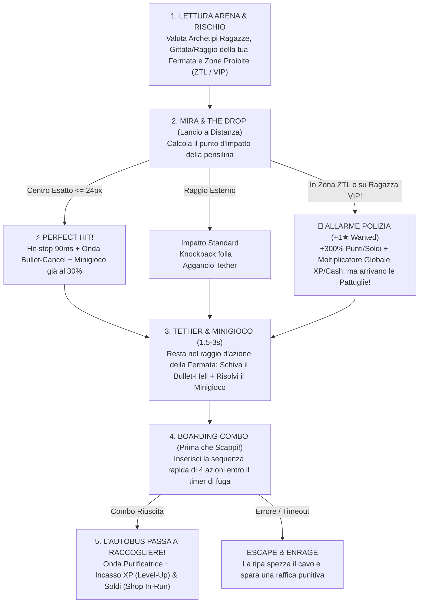

# 🚍 GIRLBUS: NEON STOP — Game Design Document (GDD v2.0 - Allineato)
> **Studio Pillar**: *"Se Rockstar Games facesse un 2D Pixel-Art Rogue-lite Bullet-Hell su rimorchiare ragazze alle fermate dell'autobus sotto pioggia acida, volanti della polizia e synthwave."*
> **Core References**: *Katana ZERO* (Personaggio a piedi agile, Chronos, Hit-Stop, Neon-Noir, VHS Glitch) × *PokéBonk / Vampire Survivors* (Arena Continua Evolvibile, Orde Esponenziali, Telegraphs) × *Stardew Valley* & *Pragmata* (Tensione Micro-Minigioco in Tempo Reale) × *GTA* (Sistema Wanted a Stelle Polizia Risk/Reward).

---

## 1. Visione, Protagonista & Controlli ("The Katana-Bonk Fusion")

### 1.1 Chi Controlliamo e Come si Muove
* **Avatar a Piedi Stile *Katana ZERO***: Il giocatore controlla un protagonista a piedi agile e letale (hitbox compatta per il bullet-hell), dotato di **Movimento 360°**, **Dash con i-frames** (per attraversare muri di proiettili) e **Lancio Tattico della Fermata**.
* **Il Ruolo dell'Autobus**: L'autobus non si guida manualmente nel traffico; è una **forza della natura neon** che sfreccia a raccogliere le ragazze ogni volta che completi la combo di una fermata (o travolge i nemici lungo i binari della *Linea Express*).
* **Schema di Input Unificato (Linux PC + Web Browser + Android Touch)**:
  * **Mano Sinistra (`WASD` / `Stick Sinistro` / `Virtual Stick`)**: Movimento + Dash.
  * **Mano Destra (`Mouse` / `Stick Destro` / `Touch Drag`)**: Mira e Lancia la Fermata entro la gittata dell'archetipo scelto.
  * **Input Minigiochi & Combo Finale (`4 Direzioni / Face Buttons / Tap Icone Olografiche`)**: Sequenze fulminee da **1.5–3.0 secondi** eseguibili senza staccare gli occhi dal bullet-hell, con adattamento automatico a pulsanti olografici touch su Android.

### 1.2 Matrice di Fusione Sensoriale & UI Diegetica

| Riferimento | Cosa Prendiamo | Traduzione Meccanica in `girlbusAG` | Specifica Tecnica di Game Feel |
| :--- | :--- | :--- | :--- |
| **Katana ZERO** | Chronos (Slow-Mo), Hit-Stop brutale, VHS Rewind, Neon-Noir | **Chronos "Rizz-Focus"**: rallenta il bullet-hell attorno alla fermata (`0.25x`). **VHS Rewind**: ogni morte (*Heartbreak*) riavvolge il nastro magnetico della partita. | • **Hit-stop**: `45 ms` aggancio base, `90 ms` *Perfect Drop*, `140 ms` *Boss Break*. • **Audio Ducking**: filtro Passa-Basso (`800 Hz`) sul synthwave durante il Chronos. |
| **PokéBonk** | Arena continua, auto-impulsi per la folla minore, telegraph a corsie | Il protagonista emette un **impulso ritmico passivo** (*Bassline Pulse*) per respingere i disturbi minori, mentre le **Ragazze e i Boss** si catturano attivamente piazzando le **Fermate**. | • **Run Rapida**: **8–10 minuti** ad altissima intensità. • **Telegraph Corsie**: linee LED rosse (`0.8s`) prima di cariche, laser o volanti della Polizia. |
| **Stardew Valley** | Barra d'inerzia con *Sweet Spot* mobile | **Minigioco "Tension-Lock"**: barra olografica verticale a fianco della fermata; tieni il cursore sull'icona della ragazza con tap ritmici mentre schivi i proiettili. | • **Decay**: `-18%/s` fuori zona; `+30%` carica istantanea se hai centrato il *Perfect Hit*. |
| **Pragmata** | Griglia di nodi in tempo reale durante il combattimento | **Minigioco "Route-Hack"**: griglia `3x3` o `4x4` stile display LED dell'autobus. Collega Start a **`[BOARD]`** passando su nodi **Blu** (`+XP/Soldi`) e **Gialli** (*Freeze Proiettili / Scudo*). | • **Persistenza**: se smetti di premere per fare un Dash schivata, il cursore **resta dov'è**. • **Punizione Hit**: se subisci danno, il percorso si resetta. |

* **Regola d'Oro UI Diegetica**: Zero pop-up modali. I minigiochi sono ologrammi al neon ancorati in *world-space* accanto alla fermata (`75%` opacità, colori freddi Ciano/Verde contro i proiettili nemici Rosso/Magenta/Giallo).

---

## 2. Il Core Gameplay Loop & Uso Strategico delle Fermate

### 2.1 Perché Piazzare la Fermata Attiva il Cervello
1. **Gittata di Lancio & Raggio d'Azione Differenziati per Fermata**:
   * La fermata si **mira e lancia a distanza** (Mouse / Stick Destro / Drag), ma **ogni tipo di fermata ha una propria Gittata di Lancio e un proprio Raggio d'Azione (Area di Cattura)**.
   * *Esempio*: una fermata a corto raggio ma area enorme ti costringe a buttarti nella mischia; una fermata da cecchino a lungo raggio ma area stretta richiede un *Perfect Hit* chirurgico da lontano.
2. **Orientamento & Copertura**: La vetrata posteriore della pensilina blocca fino a `N` proiettili da quella direzione, offrendoti un riparo tattico temporaneo mentre completi il minigioco.
3. **Il Vincolo del Tether**: Una volta agganciata una o più ragazze, devi restare dentro il **Raggio d'Azione** della fermata per far avanzare il minigioco. Uscire dal raggio congela il progresso e accelera la fuga della ragazza.
4. **Topologia di Rete ("Linee Urbane")**: Quando sblocchi 2+ fermate simultanee in-run, piazzarle collegate crea una **Corsia Preferenziale Neon** che rallenta i nemici e accelera il giocatore.

---

## 3. Sistema Polizia ("Wanted ★ Heat System"): Alto Rischio, Alti Guadagni

L'intera ambientazione è **100% adulta** (Campus Universitario, Distretto Corporate, Vita Notturna Urbana). All'interno dell'arena esistono però **Bersagli e Zone Proibite** che il giocatore non dovrebbe toccare se vuole una vita tranquilla... ma che pagano una fortuna se ha il coraggio di sfidare la legge!

### 3.1 Cosa Fa Scattare la Polizia
1. **Bersagli "Off-Limits" (Ragazze VIP / Scortate / Partner di Pezzi Grossi)**: Riconoscibili da un'aura dorata/lampeggiante. Rimorchiarle paga **3x Punti e Soldi**, ma aggiunge immediatamente **+1★ (o +2★) di Livello Ricercato**.
2. **Zone Divieto di Sosta / ZTL / Corsie Riservate**: Aree lampeggianti sull'asfalto dove fermare l'autobus è illegale. Piazzare una fermata dentro una ZTL potenzia il raggio della fermata del `+25%` e triplica il drop delle ragazze catturate lì dentro, ma fa scattare subito la sirena della Polizia!

### 3.2 Escalation delle Stelle Polizia (1★ → 5★): Più Difficoltà = Più XP e Soldi!
Scatenare la Polizia è una **scelta strategica di Risk/Reward**: ogni Stella Polizia aumenta brutalmente la difficoltà del bullet-hell nell'arena, ma **applica un Moltiplicatore Globale a TUTTI gli XP e i Soldi ottenuti**!

| Livello Sospetto | Forze di Polizia in Arena (Difficoltà Bullet-Hell) | Moltiplicatore Globale XP & Soldi | Come Azzerare / Ridurre le Stelle |
| :--- | :--- | :---: | :--- |
| **0★ (Pulito)** | Nessuna polizia. Solo i pattern bullet-hell delle ragazze nell'arena. | **`1.0x`** (Base) | — |
| **1★ (Segnalato)** | **Vigili / Droni Multa**: sparano proiettili lenti "Verbale" che rallentano se ti colpiscono. | **`1.3x XP / +40% Soldi`** | Non commettere infrazioni ZTL/VIP per `25s` continui. |
| **2★ (Ricercato)** | **Volanti della Polizia**: attraversano le corsie dell'arena a sirene spiegate (telegraph `0.8s`) sparando raffiche radiali blu/rosse. | **`1.6x XP / +80% Soldi`** | Pagare la **Tangente / Cauzione** a un Distributore Neon in arena, o resistere `40s` pulito. |
| **3★ (Posto di Blocco)** | **Barriere Laser & Agenti Scudo**: chiudono porzioni di mappa con strisce chiodate e sparano ventagli densi. | **`2.0x XP / +130% Soldi`** | Pagare Tangente allo Shop o **Sconfiggere il Boss del Tier corrente** (`-2★` bonus). |
| **4★ (Emergenza SWAT)** | **Furgoni Blindati & Cecchini Laser**: mirano direttamente alle tue Fermate per distruggerle prima che tu finisca la combo! | **`2.5x XP / +200% Soldi`** | Solo tramite Tangente salata allo Shop o sconfiggendo un Boss. |
| **5★ (MAX HEAT)** | **Elicottero con Faro + Pioggia Danmaku Totale**: il faro dell'elicottero ti insegue; se resti nel cono di luce piovono raffiche incessanti a 360°. | **`3.5x XP / +300% Soldi`** *(Jackpot per pro-player!)* | Sopravvivere a 5★ per `60s` sblocca una Challenge speciale; riducibile solo con Boss Kill o Mega-Tangente. |

---

## 4. Struttura della Partita (8–10 Minuti) & I 6 Boss Gatekeeper

La partita si svolge in un'**Arena Continua Evolvibile** (stile *Vampire Survivors / PokéBonk*) della durata di **8–10 minuti**.
* **Passaggio di Livello / Tier di Difficoltà**: Il passaggio da un livello di difficoltà della partita al successivo non avviene col semplice scorrere del cronometro, ma **sconfiggendo un Boss Gatekeeper**!
* **Estrazione Rogue-lite dal Pool dei 6 Boss**: Ad ogni partita vengono estratti **4 Boss** dal pool dei 6 personaggi iconici (uno ogni ~2.2 minuti), con **La Rettrice** o **La Mamma** sempre nel ruolo di Boss Finale della run. Questo garantisce che ogni partita da 8–10 minuti sia sempre diversa!

### 4.1 Come si Sconfigge un Boss: *"Boss 3-Stop Break"*
I Boss non muoiono sparandogli a caso: hanno una barra **"Autorità / Orgoglio" divisa in 3 Fasi (3 Scudi)**.
1. Per rompere ciascuna delle 3 fasi, devi **centrare il Boss con una Fermata**, resistere dentro il raggio al suo **Pattern Bullet-Hell Speciale** mentre completi il Minigioco, e chiudere la **Boarding Combo**.
2. A ogni fase spezzata, il Boss va in *Enrage*, cambia pattern di attacco e chiama rinforzi.
3. Spezzata la **3ª Fase**, il Boss cede e viene caricato sull'Autobus! Rilascia una **Cassa Boss (Upgrade Leggendario + Pioggia di Soldi)**, riduce di `-2★` la Polizia e **fa scattare istantaneamente il Tier di Difficoltà successivo dell'arena** (nuovi archetipi di ragazze, densità orde aumentata, musica che sale di BPM).

### 4.2 I 6 Boss del Gioco (Meccaniche & Pattern)

| Boss | Fascia Pool | Personalità & Gimmick Tattico | Pattern Bullet-Hell & Attacco alle Fermate | Cosa Succede quando la Batti (Cambio Difficoltà) |
| :--- | :---: | :--- | :--- | :--- |
| **1. La Migliore Amica** | **Tier 1 / 2** *(Min 2:00 o 4:30)* | **"Cockblock & Gelosia"**: corre tra te e le altre ragazze; se piazzi una fermata, cerca di **spingere fuori dal raggio** le tipe comuni per non fartele rimorchiare! | Spara onde sonore *"Lasciala stare!"* che applicano Knockback al giocatore + anelli di cuori spezzati rimbalzanti. | **Passaggio a Difficoltà II**: la velocità di movimento delle orde sale del `+15%` e compaiono le prime **Ragazze VIP**. |
| **2. L'Amante** | **Tier 1 / 2** *(Min 2:00 o 4:30)* | **"Doppio Gioco & Illusioni"**: genera **2 Cloni Ologramma** identici. Se piazzi la fermata sul clone falso, la fermata va in cooldown a vuoto e il clone esplode! | Spara ventagli di lame/rossetto a incrocio da 3 angolazioni diverse (Boss vero + 2 cloni) che convergono sul giocatore. | **Passaggio a Difficoltà II/III**: sblocca gli spawn notturni densi e raddoppia le **Zone ZTL** sull'asfalto. |
| **3. La Professoressa** | **Tier 2 / 3** *(Min 4:30 o 7:00)* | **"Esame a Sorpresa"**: quando la agganci con una fermata, il minigioco diventa più severo: **se sbagli un singolo tasto della Combo finale, ti "Boccia"** (stordimento `1s` + fermata distrutta!). | Traccia enormi **Squadre e Goniometri Laser** che ruotano sull'arena + pioggia di gessetti rossi ad alta velocità. | **Passaggio a Difficoltà III**: le ragazze comuni iniziano a sparare pattern composti a 2 fasi. |
| **4. La Dirigente Aziendale** | **Tier 2 / 3** *(Min 4:30 o 7:00)* | **"Hostile Takeover & Scorta"**: scende in campo circondata da **4 Stagiste/Bodyguard** collegate a lei; finché non agganci anche la scorta nel raggio della fermata, il suo scudo si rigenera. | Spara **Muri di Contratti (Red-Tape)** che dividono l'arena in corridoi stretti + valigette esplosive a tempo. | **Passaggio a Difficoltà III/IV**: compaiono gli archetipi avanzati (*Cyber-Gyaru* e *Office Lady*) in massa. |
| **5. La Rettrice** | **Tier 4 (Boss Finale A)** *(Min 9:00)* | **"Legge Marziale Accademica"**: trasforma metà dell'arena in **Zona ZTL Rossa**. Ogni fermata che non sia un *Perfect Hit* fa salire immediatamente la **Polizia di +1★**! | Evoca colonne di sigilli orbitali che sparano raggi incrociati a tutta mappa + onde radiali concentriche. | **Vittoria della Run (o Loop Overdrive)**: Cassa Finale + Sblocco Challenge Accademiche. |
| **6. La Mamma** | **Tier 4 (Boss Finale B)** *(Min 9:00)* | **"In Punizione! (Grounded)"**: l'autorità suprema. I suoi attacchi speciali non fanno solo danno: **ti "sequestrano" temporaneamente 1 Perk o 1 Slot Fermata per `8 secondi`** se vieni colpito! | **"La Ciabatta Boomerang a Ricerca"** (proiettile gigante che curva verso di te e torna indietro) + onde d'urto *"Torna a casa!"* a 360°. | **Vittoria della Run (o Loop Overdrive)**: Cassa Finale + Sblocco Challenge Leggendarie. |

---

## 5. Archetipi di Fermate, Ragazze e Minigiochi

Ogni fermata ha **Gittata di Lancio**, **Raggio d'Azione**, **Perk**, **Minigioco** e un bonus di **Affinità (`SYNERGY`)** se usata sulla ragazza dello stesso archetipo:

| Archetipo Fermata & Ragazza | 🎯 Gittata Lancio & Raggio Azione | 🚏 Perk della Fermata | 💃 Pattern Bullet-Hell della Tipa | 🎮 Minigioco (1.5–3.0s) | 💜 Match Perfetto (Affinità) |
| :--- | :--- | :--- | :--- | :--- | :--- |
| **1. EMO** *(Pensilina Grunge Viola)* | **Gittata**: Media (`220px`) **Raggio**: Ampio (`140px`) | **Melancholic Fog**: nebbia che rallenta del `30%` tutti i proiettili nel raggio e carica il Chronos. | **Razor Cross**: spirali lente che dopo `1.0s` si spezzano in croci diagonali veloci. | **Rhythm-Lock**: premi le 4 direzioni/azioni a tempo col basso post-punk quando le note toccano il centro. | **`SOULMATE`**: La nebbia assorbe 1 hit gratis + Finestra combo `+40%` + Droppa *Black Heart* (Cura). |
| **2. STUDENTESSA (Uni)** *(Pensilina Campus LED)* | **Gittata**: Lunga (`300px`) **Raggio**: Medio (`105px`) | **Campus Bell**: ogni `3.5s` suona la campanella che respinge (*Knockback*) le folle e le pattuglie vicine. | **Protractor Laser**: linee laser geometriche (`0.7s` telegraph) + aeroplanini di carta rimbalzanti. | **Pragmata Grid (`4x4`)**: collega Start a `[PASS]` toccando nodi **Blu** (`+XP`) e **Gialli** (*Freeze Laser*). | **`HONOR ROLL`**: 1 nodo Blu e 1 Giallo già attivi + Stordisce le Studentesse nel raggio per `1.2s`. |
| **3. KAWAII** *(Pensilina Ombrellino Rosa)* | **Gittata**: Corta (`150px`) **Raggio**: Compatto (`85px`) | **Purikura Umbrella**: devia i proiettili verticali e trasforma le goccioline sfiorate in scintille a ricerca. | **Sweatdrop Rain**: pioggia densa di **Goccioline Anime** 💧 rimbalzanti + anelli di cuoricini. | **"Schiva le Goccioline!" (Tear-Graze)**: danza sotto l'ombrellino sfiorando (*Graze* `<= 22px`) le goccioline blu/rosa senza toccarle! | **`MOE CRITICAL`**: Raggio di *Graze* raddoppiato + Ogni gocciolina sfiorata cancella 2 proiettili nemici. |
| **4. CYBER-GYARU** *(Pensilina Hologram 5G)* | **Gittata**: Molto Lunga (`360px`) **Raggio**: Esteso (`165px`) | **5G Hotspot Chain**: fulmina i nemici che tagliano il cavo Tether e si collega alle altre fermate a distanza `+50%`. | **Ring-Light Flash**: coni fotografici accecanti + droni che sparano raffiche triforcute. | **Stardew Valley Bar**: tieni il cursore verde sull'icona *Trending* che scatta in alto e in basso. | **`VIRAL #1`**: Cursore Stardew `+35%` più grande + Emette un *Mega-Flash* che stordisce l'orda per `2s`. |

---

## 6. La "Castrazione" Iniziale Pura, Economia XP/Soldi & Sbloccabili via Challenge

### 6.1 Puro Rogue-like: Si Riparte SEMPRE "Castrati" a Inizio Partita!
Non esistono potenziamenti statistici permanenti (`+danno` o `-cooldown` comprati fuori partita) che rovinano il bilanciamento: **ogni partita inizia con lo stesso punto di partenza "castrato" e brutale**, e la scalata verso il *God-Mode* avviene **interamente dentro gli 8–10 minuti della run**.

| Parametro | 🔒 Punto di Partenza ("Castrato" - Minuto 0:00) | 🔓 Dopo Boss 1–2 (Minuto 3:00–5:00) | 🔥 Climax pre-Boss Finale (Minuto 8:00+) |
| :--- | :--- | :--- | :--- |
| **Cooldown Fermata** | **`12.0 secondi`** (se sbagli il lancio sei nei guai) | `6.0 secondi` (`-35%` su Perfect Hit) | **`1.5 secondi`** (Reset istantaneo su *Multi-Perfect*) |
| **Fermate Attive in Arena** | **`1 sola Fermata`** | `2 Fermate` (sblocco *Linea Urbana*) | **`4–5 Fermate`** di archetipi misti con *Zona Capolinea* |
| **Multi-Hook (Orda)** | **`1 sola ragazza`** agganciata per fermata | `3–4 ragazze` simultanee | **`10–15+ ragazze`** catturate con 1 solo Minigioco + Combo! |
| **Chronos (Slow-Mo)** | **`0% Slow-Mo (1.0x)`** — risolvi il minigioco a velocità reale! | `0.60x` per `1.5s` su aggancio | **`0.20x` ("Katana Zero Time")** dentro il raggio della pensilina |
| **Gittata & Raggio** | Valori base ridotti del `-25%` | Valori standard dell'archetipo | **`+60%` Raggio d'Azione** con onde d'urto a catena |

### 6.2 Economia In-Run: XP vs Soldi (Cash)
* **XP (Esperienza)**: Si ottiene catturando ragazze e sconfiggendo Boss (moltiplicata fino a `3.5x` dalle Stelle Polizia!). Ad ogni Level-Up scegli **1 di 3 Upgrade** per potenziare le tue fermate, ridurre il cooldown o aumentare il Multi-Hook.
* **Soldi (Cash `$`)**: Si ottengono con le catture, i bersagli **VIP / ZTL (`3x`)** e il moltiplicatore **Polizia (`+300%` a 5★)**. Si spendono **solo dentro la partita** presso i **Chioschi / Distributori Neon** nell'arena per:
  1. Comprare **Nuove Tipologie di Fermate** o **Reliquie/Moduli Rari**.
  2. Comprare **Caffè Espresso / Kit Rizz** (Cura HP / Ricarica Chronos).
  3. **Pagare la Cauzione / Tangente** per azzerare o ridurre le Stelle della Polizia quando il bullet-hell a 4★–5★ diventa insostenibile!

### 6.3 Progressione Tra le Partite: Sbloccabili tramite Challenge!
Tra una partita e l'altra non compri statistiche, ma sblocchi **contenuti orizzontali e cosmetici** completando **Challenge specifiche in partita**:

| Categoria Sbloccabile | Esempio di Challenge in Partita | Cosa Sblocca per le Partite Future |
| :--- | :--- | :--- |
| 🗺️ **Nuove Mappe / Arene** | *"Sconfiggi La Rettrice con almeno 3★ di Polizia attive"* | **Mappa "Cyber-Shibuya Crossing"** (nuovi incroci ZTL, treni sopraelevati e pool ragazze inedito). |
| 🚏 **Nuove Fermate (Pool & Starter)** | *"Cattura 8 ragazze contemporaneamente con una sola Fermata"* | **Fermata Goth-Industrial** o **Fermata VIP Limousine** selezionabile a inizio run o trovabile negli Shop. |
| 🎨 **Skin Protagonista, Pensiline & Bus** | *"Sopravvivi per 60 secondi a 5★ di Polizia senza subire danni"* | **Skin "Cyber-Samurai Zero"** per il protagonista + **Autobus Dorato Drift** + **Pensiline Olografiche Arcade**. |
| 🎭 **Modificatori & Boss Rush** | *"Batti tutti e 6 i Boss del gioco almeno una volta"* | Modalità **"Rush Orario di Punta"** (tutti e 6 i Boss in una singola run estrema). |

---

## 7. Multiplayer Cooperativo (2–4 Giocatori): "Caos Condiviso"

Il loop è progettato per una modalità Co-op da 2 a 4 giocatori esaltante, dove l'avidità di un singolo giocatore può mettere nei guai (o arricchire!) tutta la squadra:

1. **Stelle Polizia Globali, Portafoglio Soldi Individuale ("Caos Condiviso")**:
   * Se il Giocatore 2 decide di fare il matto e piazza una fermata in **Zona ZTL** su una **Ragazza VIP**, le **Stelle della Polizia salgono per TUTTA la squadra**!
   * Tutti i giocatori beneficiano del moltiplicatore globale di XP e Soldi (`fino a 3.5x`), ma devono sopravvivere insieme alle Volanti e all'Elicottero SWAT — mentre **i Soldi raccolti sono individuali** e ognuno li spende per sé ai Distributori Neon (o fa la colletta per pagare la Tangente!).
2. **Rianimazione Tattica con la Fermata ("Bus Stop Revive")**:
   * Se un compagno viene abbattuto dal bullet-hell, **non basta toccarlo**: devi **lanciargli sopra una Fermata dell'Autobus** e completare un rapido minigioco di emergenza per farlo rimettere in piedi quando passa il Bus!
3. **Bolla Chronos Locale**:
   * Il Chronos rallenta il tempo (`0.25x`) solo **dentro il raggio della fermata** di chi lo attiva; i compagni fuori dalla bolla si muovono a velocità `1.0x` e possono correre dentro la bolla come *Wingman* per intercettare i proiettili mentre l'amico risolve il minigioco del Boss.
4. **Linea Express ("Ghost Bus Rush") & Boss Dual-Catch**:
   * Piazzare due fermate di due giocatori entro `450px` accende il **Binario Express**: quando entrambi chiudono una combo, l'**Autobus Fantasma Neon** travolge tutto lungo la linea che unisce le due fermate!
   * Contro i **Boss (Rettrice, Mamma, Professoressa, ecc.)**, i giocatori possono concatenare le fermate per rompere insieme gli scudi del *3-Stop Break*.
