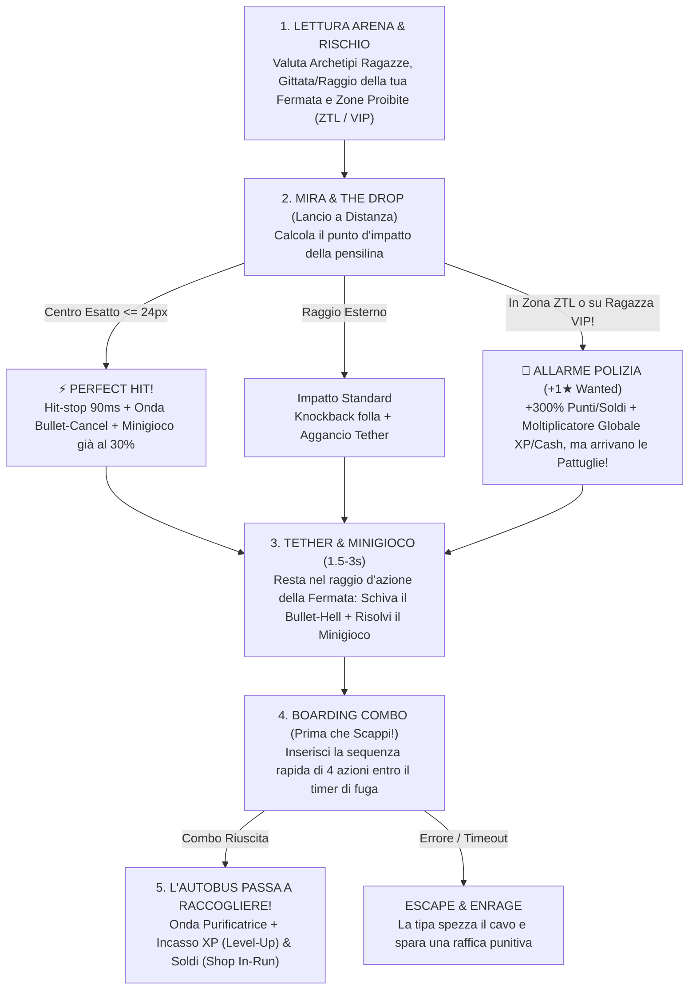

# 🚍 GIRLBUS: NEON STOP — Game Design Document (GDD v2.4 - Build Stabile Pre-Espansione, Ergonomia & Roadmap Espansione)
> **Studio Pillar**: *"Se Rockstar Games facesse un 2D Pixel-Art Rogue-lite Bullet-Hell su rimorchiare ragazze alle fermate dell'autobus sotto pioggia acida, volanti della polizia e synthwave."*
> **Core References**: *Katana ZERO* (Personaggio a piedi agile, Chronos, Hit-Stop, Neon-Noir, VHS Glitch) × *PokéBonk / Vampire Survivors* (Arena Continua Evolvibile, Orde Esponenziali, Telegraphs) × *Stardew Valley* & *Pragmata* (Tensione Micro-Minigioco in Tempo Reale) × *GTA* (Sistema Wanted a Stelle Polizia Risk/Reward).

---

## 1. Visione, Protagonista & Controlli ("The Katana-Bonk Fusion")

### 1.1 Chi Controlliamo e Come si Muove
* **Avatar a Piedi Stile *Katana ZERO***: Il giocatore controlla un protagonista a piedi agile e letale (hitbox compatta per il bullet-hell), dotato di **Movimento 360°**, **Dash con i-frames** (per attraversare muri di proiettili) e **Lancio Tattico della Fermata**.
* **Il Ruolo dell'Autobus**: L'autobus non si guida manualmente nel traffico; è una **forza della natura neon** che sfreccia a raccogliere le ragazze ogni volta che completi la combo di una fermata (o travolge i nemici lungo i binari della *Linea Express*).
* **Schema di Input Unificato ("Zero Hand-Lift" — PC Mouse/Tastiera + Solo Tastiera + Gamepad + Android Touch)**:
  * **Mouse + Tastiera (`WASD` + Mouse)**: `WASD` movimento, `Spazio` / `Click Destro` Dash, `Shift` / `Q` Chronos (configurabile Hold o Toggle), `Rotellina Mouse` o `1–4` / `Tab` cambio Fermata senza staccare le dita dal movimento; `Click Sinistro` Mira/Lancio **e** azione 1-tasto per i minigiochi (*Emo Rhythm*, *Gyaru Stardew Hold*, *Kawaii Dance*), mentre i minigiochi direzionali (*Pragmata 4×4* e *Combo 4 Frecce*) supportano sia `Frecce / IJKL` sia selezione rapida col mouse / quadranti olografici attorno alla fermata (**zero stacco della mano destra dal mouse**).
  * **Solo Tastiera (`WASD` + `Frecce / IJKL`)**: tasto `F` / `Invio` per il lancio con **Smart Magnetic Aim** lungo la direzione di movimento con aggancio morbido verso la ragazza compatibile in gittata.
  * **Gamepad Twin-Stick**: Stick Sinistro movimento, Stick Destro mira, Grilletti (`L2/R2`) Chronos/Lancio, Dorsali (`L1/R1`) Dash/Cambio Fermata e **Tasti Frontali (`Y/B/A/X` o `△/○/×/□`)** mappati alle 4 direzioni di Minigiochi e Combo (evitando di costringere il pollice sinistro a lasciare lo Stick per il D-Pad).
  * **Android Touch**: Stick virtuale sinistro + drag mira destro + pulsanti olografici touch per Dash, Chronos, Cambio Fermata e 4 direzioni.

### 1.2 Matrice di Fusione Sensoriale & UI Diegetica

| Riferimento | Cosa Prendiamo | Traduzione Meccanica in `girlbusAG` | Specifica Tecnica di Game Feel |
| :--- | :--- | :--- | :--- |
| **Katana ZERO** | Chronos (Slow-Mo), Hit-Stop brutale, VHS Rewind, Neon-Noir | **Chronos "Rizz-Focus"**: rallenta il bullet-hell attorno alla fermata (`0.25x`). **VHS Rewind**: ogni morte (*Heartbreak*) riavvolge il nastro magnetico della partita. | • **Hit-stop**: `45 ms` aggancio base, `90 ms` *Perfect Drop*, `140 ms` *Boss Break*. • **Audio Ducking**: filtro Passa-Basso (`800 Hz`) sul synthwave durante il Chronos. |
| **PokéBonk** | Arena continua, auto-impulsi per la folla minore, telegraph a corsie | Il protagonista emette un **impulso ritmico passivo** (*Bassline Pulse*) per respingere i disturbi minori, mentre le **Ragazze e i Boss** si catturano attivamente piazzando le **Fermate**. | • **Run Rapida**: **8–10 minuti** ad altissima intensità. • **Telegraph Corsie**: linee LED rosse (`0.8s`) prima di cariche, laser o volanti della Polizia. |
| **Stardew Valley** | Barra d'inerzia con *Sweet Spot* mobile | **Minigioco "Tension-Lock"**: barra olografica verticale a fianco della fermata; tieni il cursore sull'icona della ragazza con tap ritmici mentre schivi i proiettili. | • **Decay**: `-18%/s` fuori zona; `+30%` carica istantanea se hai centrato il *Perfect Hit*. |
| **Pragmata** | Griglia di nodi in tempo reale durante il combattimento | **Minigioco "Route-Hack"**. Nella griglia `4x4` punta alla bandiera verde in basso a destra. I nodi facoltativi danno **XP** (azzurro) o rallentano i proiettili (clessidra gialla). | • **Persistenza**: se smetti di premere per fare un Dash schivata, il cursore **resta dov'è**. • **Punizione Hit**: se subisci danno, il percorso si resetta. |

* **Regola d'Oro UI Diegetica**: Zero pop-up modali. I minigiochi sono ologrammi al neon ancorati in *world-space* accanto alla fermata (`75%` opacità, colori freddi Ciano/Verde contro i proiettili nemici Rosso/Magenta/Giallo).

---

## 2. Il Core Gameplay Loop & Uso Strategico delle Fermate

### 2.1 Perché Piazzare la Fermata Attiva il Cervello
1. **Gittata di Lancio & Raggio d'Azione Differenziati per Fermata**:
   * La fermata si **mira e lancia a distanza** (Mouse / Stick Destro / Drag), ma **ogni tipo di fermata ha una propria Gittata di Lancio e un proprio Raggio d'Azione (Area di Cattura)**.
   * *Esempio*: una fermata a corto raggio ma area enorme ti costringe a buttarti nella mischia; una fermata da cecchino a lungo raggio ma area stretta richiede un *Perfect Hit* chirurgico da lontano.
2. **Orientamento & Copertura**: La vetrata posteriore della pensilina blocca fino a `N` proiettili da quella direzione, offrendoti un riparo tattico temporaneo mentre completi il minigioco.
3. **Il Vincolo del Tether**: Una volta agganciata una o più ragazze, devi restare dentro il **Raggio d'Azione** della fermata per far avanzare il minigioco. Uscire dal raggio congela il progresso e accelera la fuga della ragazza.
4. **Topologia di Rete ("Linee Urbane")**: Quando sblocchi 2+ fermate simultanee in-run, piazzarle collegate crea una **Corsia Preferenziale Neon** che rallenta i nemici e accelera il giocatore.

---

## 3. Sistema Polizia ("Wanted ★ Heat System"): Alto Rischio, Alti Guadagni

L'intera ambientazione è **100% adulta** (Campus Universitario, Distretto Corporate, Vita Notturna Urbana). All'interno dell'arena esistono però **Bersagli e Zone Proibite** che il giocatore non dovrebbe toccare se vuole una vita tranquilla... ma che pagano una fortuna se ha il coraggio di sfidare la legge!

### 3.1 Cosa Fa Scattare la Polizia
1. **Bersagli "Off-Limits" (Ragazze VIP / Scortate / Partner di Pezzi Grossi)**: Riconoscibili da un'aura dorata/lampeggiante. Rimorchiarle paga **3x Punti e Soldi**, ma aggiunge immediatamente **+1★ (o +2★) di Livello Ricercato**.
2. **Zone Divieto di Sosta / ZTL / Corsie Riservate**: Aree lampeggianti sull'asfalto dove fermare l'autobus è illegale. Piazzare una fermata dentro una ZTL potenzia il raggio della fermata del `+25%` e triplica il drop delle ragazze catturate lì dentro, ma fa scattare subito la sirena della Polizia!

### 3.2 Escalation delle Stelle Polizia (1★ → 5★): Più Difficoltà = Più XP e Soldi!
Scatenare la Polizia è una **scelta strategica di Risk/Reward**: ogni Stella Polizia aumenta brutalmente la difficoltà del bullet-hell nell'arena, ma **applica un Moltiplicatore Globale a TUTTI gli XP e i Soldi ottenuti**!

| Livello Sospetto | Forze di Polizia in Arena (Difficoltà Bullet-Hell) | Moltiplicatore Globale XP & Soldi | Come Azzerare / Ridurre le Stelle |
| :--- | :--- | :---: | :--- |
| **0★ (Pulito)** | Nessuna polizia. Solo i pattern bullet-hell delle ragazze nell'arena. | **`1.0x`** (Base) | — |
| **1★ (Segnalato)** | **Vigili / Droni Multa**: sparano proiettili lenti "Verbale" che rallentano se ti colpiscono. | **`1.3x XP / +40% Soldi`** | Non commettere infrazioni ZTL/VIP per `25s` continui. |
| **2★ (Ricercato)** | **Volanti della Polizia**: attraversano le corsie dell'arena a sirene spiegate (telegraph `0.8s`) sparando raffiche radiali blu/rosse. | **`1.6x XP / +80% Soldi`** | Pagare la **Tangente / Cauzione** a un Distributore Neon in arena, o resistere `40s` pulito. |
| **3★ (Posto di Blocco)** | **Barriere Laser & Agenti Scudo**: chiudono porzioni di mappa con strisce chiodate e sparano ventagli densi. | **`2.0x XP / +130% Soldi`** | Pagare Tangente allo Shop o **Sconfiggere il Boss del Tier corrente** (`-2★` bonus). |
| **4★ (Emergenza SWAT)** | **Furgoni Blindati & Cecchini Laser**: mirano direttamente alle tue Fermate per distruggerle prima che tu finisca la combo! | **`2.5x XP / +200% Soldi`** | Solo tramite Tangente salata allo Shop o sconfiggendo un Boss. |
| **5★ (MAX HEAT)** | **Elicottero con Faro + Pioggia Danmaku Totale**: il faro dell'elicottero ti insegue; se resti nel cono di luce piovono raffiche incessanti a 360°. | **`3.5x XP / +300% Soldi`** *(Jackpot per pro-player!)* | Sopravvivere a 5★ per `60s` sblocca una Challenge speciale; riducibile solo con Boss Kill o Mega-Tangente. |

---

## 4. Struttura della Partita (8–10 Minuti) & I 6 Boss Gatekeeper

La partita si svolge in un'**Arena Continua Evolvibile** (stile *Vampire Survivors / PokéBonk*) della durata di **8–10 minuti**.
* **Passaggio di Livello / Tier di Difficoltà**: Il passaggio da un livello di difficoltà della partita al successivo non avviene col semplice scorrere del cronometro, ma **sconfiggendo un Boss Gatekeeper**!
* **Estrazione Rogue-lite dal Pool dei 6 Boss**: Ad ogni partita vengono estratti **4 Boss** dal pool dei 6 personaggi iconici (uno ogni ~2.2 minuti), con **La Rettrice** o **La Mamma** sempre nel ruolo di Boss Finale della run. Questo garantisce che ogni partita da 8–10 minuti sia sempre diversa!

### 4.1 Come si Sconfigge un Boss: *"Boss 3-Stop Break"*
I Boss non muoiono sparandogli a caso: hanno una barra **"Autorità / Orgoglio" divisa in 3 Fasi (3 Scudi)**.
1. Per rompere ciascuna delle 3 fasi, devi **centrare il Boss con una Fermata**, resistere dentro il raggio al suo **Pattern Bullet-Hell Speciale** mentre completi il Minigioco, e chiudere la **Boarding Combo**.
2. A ogni fase spezzata, il Boss va in *Enrage*, cambia pattern di attacco e chiama rinforzi.
3. Spezzata la **3ª Fase**, il Boss cede e viene caricato sull'Autobus! Rilascia **Soldi + 1 Chiave Boss (`🔑`)**, riduce di `-2★` la Polizia e **fa scattare istantaneamente il Tier di Difficoltà successivo dell'arena** (nuovi archetipi di ragazze, densità orde aumentata, musica che sale di BPM).
   * **Forzieri Blindati Neon (Novità v2.3)**: In ogni mappa sono posizionati **Forzieri / Cassette Sicure** chiusi (`🔒`). Spendendo una **Chiave Boss** lasciata cadere da un Boss sconfitto e avvicinandosi al forziere, il giocatore lo apre ottenendo **Reliquie Rare / Upgrade Leggendari / Pack di Caffè & Cash** esclusivi.

### 4.2 I 6 Boss del Gioco (Meccaniche & Pattern)

| Boss | Fascia Pool | Personalità & Gimmick Tattico | Pattern Bullet-Hell & Attacco alle Fermate | Cosa Succede quando la Batti (Cambio Difficoltà) |
| :--- | :---: | :--- | :--- | :--- |
| **1. La Migliore Amica** | **Tier 1 / 2** *(Min 2:00 o 4:30)* | **"Cockblock & Gelosia"**: corre tra te e le altre ragazze; se piazzi una fermata, cerca di **spingere fuori dal raggio** le tipe comuni per non fartele rimorchiare! | Spara onde sonore *"Lasciala stare!"* che applicano Knockback al giocatore + anelli di cuori spezzati rimbalzanti. | **Passaggio a Difficoltà II**: la velocità di movimento delle orde sale del `+15%` e compaiono le prime **Ragazze VIP**. |
| **2. L'Amante** | **Tier 1 / 2** *(Min 2:00 o 4:30)* | **"Doppio Gioco & Illusioni"**: genera **2 Cloni Ologramma** identici. Se piazzi la fermata sul clone falso, la fermata va in cooldown a vuoto e il clone esplode! | Spara ventagli di lame/rossetto a incrocio da 3 angolazioni diverse (Boss vero + 2 cloni) che convergono sul giocatore. | **Passaggio a Difficoltà II/III**: sblocca gli spawn notturni densi e raddoppia le **Zone ZTL** sull'asfalto. |
| **3. La Professoressa** | **Tier 2 / 3** *(Min 4:30 o 7:00)* | **"Esame a Sorpresa"**: quando la agganci con una fermata, il minigioco diventa più severo: **se sbagli un singolo tasto della Combo finale, ti "Boccia"** (stordimento `1s` + fermata distrutta!). | Traccia enormi **Squadre e Goniometri Laser** che ruotano sull'arena + pioggia di gessetti rossi ad alta velocità. | **Passaggio a Difficoltà III**: le ragazze comuni iniziano a sparare pattern composti a 2 fasi. |
| **4. La Dirigente Aziendale** | **Tier 2 / 3** *(Min 4:30 o 7:00)* | **"Hostile Takeover & Scorta"**: scende in campo circondata da **4 Stagiste/Bodyguard** collegate a lei; finché non agganci anche la scorta nel raggio della fermata, il suo scudo si rigenera. | Spara **Muri di Contratti (Red-Tape)** che dividono l'arena in corridoi stretti + valigette esplosive a tempo. | **Passaggio a Difficoltà III/IV**: compaiono gli archetipi avanzati (*Cyber-Gyaru* e *Office Lady*) in massa. |
| **5. La Rettrice** | **Tier 4 (Boss Finale A)** *(Min 9:00)* | **"Legge Marziale Accademica"**: trasforma metà dell'arena in **Zona ZTL Rossa**. Ogni fermata che non sia un *Perfect Hit* fa salire immediatamente la **Polizia di +1★**! | Evoca colonne di sigilli orbitali che sparano raggi incrociati a tutta mappa + onde radiali concentriche. | **Vittoria della Run (o Loop Overdrive)**: Cassa Finale + Sblocco Challenge Accademiche. |
| **6. La Mamma** | **Tier 4 (Boss Finale B)** *(Min 9:00)* | **"In Punizione! (Grounded)"**: l'autorità suprema. I suoi attacchi speciali non fanno solo danno: **ti "sequestrano" temporaneamente 1 Perk o 1 Slot Fermata per `8 secondi`** se vieni colpito! | **"La Ciabatta Boomerang a Ricerca"** (proiettile gigante che curva verso di te e torna indietro) + onde d'urto *"Torna a casa!"* a 360°. | **Vittoria della Run (o Loop Overdrive)**: Cassa Finale + Sblocco Challenge Leggendarie. |

---

## 5. Archetipi di Fermate, Ragazze e Minigiochi

Ogni fermata ha **Gittata di Lancio**, **Raggio d'Azione**, **Perk**, **Minigioco** e un bonus di **Affinità (`SYNERGY`)** se usata sulla ragazza dello stesso archetipo:

| Archetipo Fermata & Ragazza | 🎯 Gittata Lancio & Raggio Azione | 🚏 Perk della Fermata | 💃 Pattern Bullet-Hell della Tipa | 🎮 Minigioco (1.5–3.0s) | 💜 Match Perfetto (Affinità) |
| :--- | :--- | :--- | :--- | :--- | :--- |
| **1. EMO** *(Pensilina Grunge Viola)* | **Gittata**: Media (`220px`) **Raggio**: Ampio (`140px`) | **Melancholic Fog**: nebbia che rallenta del `30%` tutti i proiettili nel raggio e carica il Chronos. | **Razor Cross**: spirali lente che dopo `1.0s` si spezzano in croci diagonali veloci. | **Rhythm-Lock**: premi le 4 direzioni/azioni a tempo col basso post-punk quando le note toccano il centro. | **`SOULMATE`**: La nebbia assorbe 1 hit gratis + Finestra combo `+40%` + Droppa *Black Heart* (Cura). |
| **2. STUDENTESSA (Uni)** *(Pensilina Campus LED)* | **Gittata**: Lunga (`300px`) **Raggio**: Medio (`105px`) | **Campus Bell**: ogni `3.5s` suona la campanella che respinge (*Knockback*) le folle e le pattuglie vicine. | **Protractor Laser**: linee laser geometriche (`0.7s` telegraph) + aeroplanini di carta rimbalzanti. | **Pragmata Grid (`4x4`)**. Raggiungi la bandiera verde. I nodi facoltativi danno `20 XP` base (azzurro) o portano i proiettili all'`8%` della velocità per `1.5s` (giallo). | **`HONOR ROLL`**: 1 nodo Blu e 1 Giallo già attivi + Stordisce le Studentesse nel raggio per `1.2s`. |
| **3. KAWAII** *(Pensilina Ombrellino Rosa)* | **Gittata**: Corta (`150px`) **Raggio**: Compatto (`85px`) | **Purikura Umbrella**: devia i proiettili verticali e trasforma le goccioline sfiorate in scintille a ricerca. | **Sweatdrop Rain**: pioggia densa di **Goccioline Anime** 💧 rimbalzanti + anelli di cuoricini. | **"Schiva le Goccioline!" (Tear-Graze)**: danza sotto l'ombrellino sfiorando (*Graze* `<= 22px`) le goccioline blu/rosa senza toccarle! | **`MOE CRITICAL`**: Raggio di *Graze* raddoppiato + Ogni gocciolina sfiorata cancella 2 proiettili nemici. |
| **4. CYBER-GYARU** *(Pensilina Hologram 5G)* | **Gittata**: Molto Lunga (`360px`) **Raggio**: Esteso (`165px`) | **5G Hotspot Chain**: fulmina i nemici che tagliano il cavo Tether e si collega alle altre fermate a distanza `+50%`. | **Ring-Light Flash**: coni fotografici accecanti + droni che sparano raffiche triforcute. | **Stardew Valley Bar**: tieni il cursore verde sull'icona *Trending* che scatta in alto e in basso. | **`VIRAL #1`**: Cursore Stardew `+35%` più grande + Emette un *Mega-Flash* che stordisce l'orda per `2s`. |

### 5.1 Espansione Roster Futuro — Nuove Mappe & Archetipi di Ragazze (Specifica Design v2.3)

Per dare progressione reale alle future **Nuove Mappe Sbloccabili**, i nuovi archetipi di Ragazze & Fermate non entrano tutti insieme fin dall'inizio: **vengono sbloccati progressivamente man mano che il giocatore sblocca nuove arene**:

1. **🎻 Ragazza Musicista (*Chitarra Elettrica / Violino Neon*) — Minigioco "Virtuoso Hero" (Stile *Guitar Hero* + Time-Freeze)** *(Sbloccabile su Mappa "Cyber-Shibuya Crossing / Distretto Club")*:
   * **Avatar & Arma Scenica**: Musicista glam/rock-classica con **chitarra elettrica al neon** oppure **violino elettrico luminoso** (variante visiva in-run).
   * **Pattern Bullet-Hell**: onde sonore a pentagramma e raffiche ritmiche di "note/accordi" con telegraph visivo sul tempo della musica.
   * **Perk Pensilina (*Palco Acustico*)**: amplifica il *Bassline Pulse* e ricarica lentamente il Chronos finché stai dentro il raggio.
   * **Minigioco Dedicato — "Virtuoso Hero" (4 Colonne + Time-Freeze)**:
     * All'aggancio, la fermata genera una **bolla di Time-Freeze temporaneo** (`2.5–3.5s`) per permettere al giocatore di concentrarsi al 100% sull'esecuzione musicale senza rischi letali immediati.
     * Compaiono **4 colonne verticali** (come *Guitar Hero*) in cui scendono pallini/note a tempo sul motivo musicale.
     * Controlli unificati: 4 colonne mappate su `A/S/D/F`, `Frecce/IJKL`, 4 tasti frontali Gamepad (`Y/B/A/X`) oppure clic diretti sulle 4 tracce touch/mouse.
     * **Valutazione Timing**: ogni nota presa assegna **`PERFECT`**, **`GOOD`** o **`MISS`**; precisione alta e Combo di note moltiplicano **XP, Cash (`fino a 2.5x`)** e potenziano l'onda finale **Encore Bullet-Clear** quando passa il Bus.

2. **🏋️‍♀️ Ragazza Palestrata (*Fitness / Gym-Crush*) — Minigioco "Max Trazioni" & Alternative** *(Sbloccabile su Mappa "Neon Iron District / Zona Fitness")*:
   * **Identità & Pattern Bullet-Hell**: atleta iper-energetica con manubri neon; lancia dischi/kettlebell rimbalzanti e onde d'urto a terra in palestra urbana.
   * **Perk Pensilina (*Rack Corazzato*)**: vetrata posteriore rinforzata con scudi extra e *knockback* fisico contro chi entra nel cerchio.
   * **Proposta Principale — "Max Trazioni / Pull-Up Mash" (Idea Luca)**: finestra intensa di `3.0–4.0s` in cui devi premere **il più velocemente possibile il tasto sinistro del mouse (`LMB`)** (o `SPACE`) per accumulare il massimo numero di trazioni alla sbarra prima dello scadere del tempo; ogni soglia superata (`5 / 10 / 15+ trazioni`) aumenta il punteggio Rizz/Cash e libera una scarica muscolare che respinge i nemici vicini.
   * **Proposte Alternative da Valutare**:
     * *Proposta A — "Max-Rep Spotter" (3 Serie Timing)*: 3 barre di sollevamento a velocità crescente dove devi fermare l'indicatore nella zona dorata (*PR! Personal Record*) per liberare una scarica d'urto.
     * *Proposta B — "Kettlebell Rhythm-Pump"*: tieni premuto per caricare la spinta e rilascia al picco ottimale; ogni ripetizione pulita scaglia un manubrio olografico contro i proiettili in arrivo.

3. **🏐 Ragazza Pallavolista (*Volley Ace*) — Minigioco "Mini-Partita / Spike" *(Idee in Definizione)*** *(Sbloccabile su Mappa "Lungomare Sunset / Arena Volley")*:
   * **Identità & Pattern Bullet-Hell**: schiacciatrice da torneo notturno; esegue *Jump Serve* ad arco parabolico con ombra d'impatto sull'asfalto e "muri" lineari a rete.
   * **Perk Pensilina (*Rete Rimbalzante*)**: la parte superiore della pensilina diventa una rete elastica che rimanda indietro parte dei proiettili nemici.
   * **Proposte Minigioco da Valutare**:
     * *Proposta A — "Mini-Rally 3-Tocchi" (Bagher → Alzata → Schiacciata)*: micro-campo olografico 2D laterale diviso da una rete; sposti il cursore/clicchi per chiudere 3 passaggi puliti e concludere con la **Schiacciata (`SPIKE!`)** che spazza i proiettili reali nell'arena.
     * *Proposta B — "Muro & Schiacciata" (Timing 2-Fasi)*: prima scegli rapidamente la corsia della battuta avversaria (sinistra/centro/destra), poi premi a tempo al culmine del salto per schiacciare a punto.
4. **🖱️ Idea Minigioco Futuro Dual-Click (`Click SX + Click DX` / `LMB + RMB`) *(Concept in Sviluppo)***:
   * **Obiettivo Ergonomico**: sfruttare **entrambi i tasti principali del mouse (`LMB` + `RMB`)** senza mai staccare le mani da `WASD` + Mouse (mantenendo `SPAZIO` sempre dedicato al Dash durante la sequenza).
   * **Possibile Meccanica**: sequenze rapide di **Parata / Contrattacco** o **Ritmo Bimanuale SX/DX** (es. indicatori ciano `LMB` e magenta `RMB` alternati su due tracce corte, o doppio-click simultaneo sul picco per bonus `2x`!).

---

## 6. La "Castrazione" Iniziale Pura, Economia XP/Soldi & Sbloccabili via Challenge

### 6.1 Puro Rogue-like: Si Riparte SEMPRE "Castrati" a Inizio Partita!
Non esistono potenziamenti statistici permanenti (`+danno` o `-cooldown` comprati fuori partita) che rovinano il bilanciamento: **ogni partita inizia con lo stesso punto di partenza "castrato" e brutale**, e la scalata verso il *God-Mode* avviene **interamente dentro gli 8–10 minuti della run**.

| Parametro | 🔒 Punto di Partenza ("Castrato" - Minuto 0:00) | 🔓 Dopo Boss 1–2 (Minuto 3:00–5:00) | 🔥 Climax pre-Boss Finale (Minuto 8:00+) |
| :--- | :--- | :--- | :--- |
| **Cooldown Fermata** | **`6.5 secondi`** (se sbagli il lancio devi aspettare o fare Graze/Parry) | `3.5–4.5 secondi` (`-35%` su Perfect Hit / Recall) | **`1.5 secondi`** (Reset istantaneo / dimezzato su *Rush Hour*) |
| **Fermate Attive in Arena** | **`1 sola Fermata`** | `2 Fermate` (sblocco *Linea Urbana*) | **`4–5 Fermate`** di archetipi misti con *Zona Capolinea* |
| **Multi-Hook (Orda)** | **`1 sola ragazza`** agganciata per fermata | `3–4 ragazze` simultanee | **`10–15+ ragazze`** catturate con 1 solo Minigioco + Combo! |
| **Chronos (Slow-Mo)** | **`0% Slow-Mo (1.0x)`** — risolvi il minigioco a velocità reale! | `0.60x` per `1.5s` su aggancio | **`0.20x` ("Katana Zero Time")** dentro il raggio della pensilina |
| **Gittata & Raggio** | Valori base ridotti del `-25%` | Valori standard dell'archetipo | **`+60%` Raggio d'Azione** con onde d'urto a catena |

### 6.2 Economia In-Run: XP, Soldi (Cash) & Chiavi Boss
* **XP (Esperienza)**: Si ottiene catturando ragazze e sconfiggendo Boss (moltiplicata fino a `3.5x` dalle Stelle Polizia!). Ad ogni Level-Up scegli **1 di 3 Upgrade** per potenziare le tue fermate, ridurre il cooldown o aumentare il Multi-Hook.
* **Soldi (Cash `$`)**: Si ottengono con le catture, i bersagli **VIP / ZTL (`3x`)** e il moltiplicatore **Polizia (`+300%` a 5★)**. Si spendono **solo dentro la partita** presso i **Chioschi / Distributori Neon** nell'arena per:
  1. Comprare **Nuove Tipologie di Fermate** o **Reliquie/Moduli Rari**.
  2. Comprare **Caffè Espresso / Kit Rizz** (Cura HP / Ricarica Chronos).
  3. **Pagare la Cauzione / Tangente** per azzerare o ridurre le Stelle della Polizia quando il bullet-hell a 4★–5★ diventa insostenibile!
* **Chiavi Boss & Forzieri nella Mappa (`🔑` -> `🔒`)**:
  * Ogni Boss sconfitto rilascia **1 Chiave Boss** raccolta automaticamente (mostrata nell'HUD).
  * In punti chiave della mappa spawnano **Forzieri Blindati Neon** (2–3 per arena) chiusi a chiave: passando vicino con una **Chiave Boss** il forziere si sblocca con animazione ed eroga **1 Reliquia garantita + Cash / Caffè Espresso**, premiando l'esplorazione attiva dell'arena dopo ogni scontro Boss!

### 6.3 Progressione Tra le Partite: Sbloccabili tramite Challenge!
Tra una partita e l'altra non compri statistiche, ma sblocchi **contenuti orizzontali e cosmetici** completando **Challenge specifiche in partita**:

| Categoria Sbloccabile | Esempio di Challenge in Partita | Cosa Sblocca per le Partite Future |
| :--- | :--- | :--- |
| 🗺️ **Nuove Mappe & Nuove Ragazze** | *"Sconfiggi La Rettrice con almeno 3★ di Polizia attive"* | **Nuove Arene** (*Cyber-Shibuya*, *Zona Fitness*, *Volley Arena*) con **nuovi archetipi di ragazze** dedicati (Musicista, Palestrata, Pallavolista). |
| 🚏 **Nuove Fermate (Pool & Starter)** | *"Cattura 8 ragazze contemporaneamente con una sola Fermata"* | **Fermata Goth-Industrial** o **Fermata VIP Limousine** selezionabile a inizio run o trovabile negli Shop. |
| 🎨 **Skin Protagonista, Costumi, Bus & Titoli** | *"Sopravvivi per 45s a 5★ senza danni" / "Affinità Totale" / "Autobus Pieno"* | **Costumi Alfredo (`Neon Drip`, `Alfredo Banana`, `Alfredo Aletta di Pollo`, `Cyber-Samurai Zero`)** + **Autobus Dorato Drift** + **Titoli Profilo** equipaggiabili. |
| 🎭 **Modificatori & Boss Rush** | *"Batti tutti e 6 i Boss del gioco almeno una volta"* | Modalità **"Rush Orario di Punta"** (tutti e 6 i Boss in una singola run estrema). |

---

## 7. Multiplayer Cooperativo (2–4 Giocatori): "Caos Condiviso"

Il loop è progettato per una modalità Co-op da 2 a 4 giocatori esaltante, dove l'avidità di un singolo giocatore può mettere nei guai (o arricchire!) tutta la squadra:

1. **Stelle Polizia Globali, Portafoglio Soldi Individuale ("Caos Condiviso")**:
   * Se il Giocatore 2 decide di fare il matto e piazza una fermata in **Zona ZTL** su una **Ragazza VIP**, le **Stelle della Polizia salgono per TUTTA la squadra**!
   * Tutti i giocatori beneficiano del moltiplicatore globale di XP e Soldi (`fino a 3.5x`), ma devono sopravvivere insieme alle Volanti e all'Elicottero SWAT — mentre **i Soldi raccolti sono individuali** e ognuno li spende per sé ai Distributori Neon (o fa la colletta per pagare la Tangente!).
2. **Rianimazione Tattica con la Fermata ("Bus Stop Revive")**:
   * Se un compagno viene abbattuto dal bullet-hell, **non basta toccarlo**: devi **lanciargli sopra una Fermata dell'Autobus** e completare un rapido minigioco di emergenza per farlo rimettere in piedi quando passa il Bus!
3. **Bolla Chronos Locale**:
   * Il Chronos rallenta il tempo (`0.25x`) solo **dentro il raggio della fermata** di chi lo attiva; i compagni fuori dalla bolla si muovono a velocità `1.0x` e possono correre dentro la bolla come *Wingman* per intercettare i proiettili mentre l'amico risolve il minigioco del Boss.
4. **Linea Express ("Ghost Bus Rush") & Boss Dual-Catch**:
   * Piazzare due fermate di due giocatori entro `450px` accende il **Binario Express**: quando entrambi chiudono una combo, l'**Autobus Fantasma Neon** travolge tutto lungo la linea che unisce le due fermate!
   * Contro i **Boss (Rettrice, Mamma, Professoressa, ecc.)**, i giocatori possono concatenare le fermate per rompere insieme gli scudi del *3-Stop Break*.

---

## 8. Ergonomia dei Comandi, Ottimizzazione del Game Feel & Evoluzione del Gameplay Loop (v2.1)

Questa sezione analizza il sistema di input reale tra tastiera, mouse e gamepad per eliminare gli attriti fisici durante il bullet-hell e introduce meccaniche ad alta profondità che arricchiscono il loop **senza aggiungere nuovi tasti complessi**.

### 8.1 Diagnosi Ergonomica & Ottimizzazioni di Controllo ("Zero Hand-Lift")
Nell'impostazione precedente emergevano 5 colli di bottiglia ergonomici evidenti quando il giocatore impugna `WASD` + Mouse o il Gamepad:
1. **"Problema delle 3 Mani" (`WASD` + Mouse + `Frecce / IJKL`)**: mentre la mano sinistra schiva con `WASD` e la destra mira col Mouse, l'ingresso nel minigioco/combo obbliga a staccare la mano destra dal mouse per premere `Frecce` o `IJKL` proprio nei 2–3 secondi di massima densità dei proiettili.
2. **Sovraccarico sul dito anulare/mignolo (`Q` / `C` + `1–4` + `Tab`)**: tenere premuto `Q` per il Chronos penalizza i movimenti verso sinistra/alto (`A` / `W`), mentre `C` collide con la selezione rapida carte Level-Up (`Z/X/C`) e `1–4` costringe a lasciare i tasti di movimento per cambiare archetipo.
3. **Conflitto `Click Destro`**: usare il tasto destro del mouse sia come *Dash* sia come *Cancel* crea attriti quando si chiudono interfacce o si schiva vicino a menu/interazioni.
4. **Mancanza di mira in Solo Tastiera**: senza puntatore mouse attivo, un giocatore che preferisce `WASD` + `Frecce/IJKL` non dispone di una mira assistita verso il bersaglio.
5. **Conflitto Gamepad sul pollice sinistro**: mappare le 4 direzioni di minigiochi/combo sul **D-Pad** impedisce di schivare simultaneamente con lo **Stick Sinistro**, lasciando invece inutilizzati lo **Stick Destro** e i **Tasti Frontali**.

#### Profili di Controllo Ottimizzati

| Profilo Input | Movimento & Schivata | Mira, Cambio Fermata & Lancio | Chronos (`Slow-Mo`) | Minigiochi & Combo 4-Step |
| :--- | :--- | :--- | :--- | :--- |
| **Mouse + Tastiera (`Zero Hand-Lift`)** | `WASD` + `Spazio` / `Click Destro` (Dash dedicato) | **Mouse** (Mira) + **Rotellina Mouse** o `1–4` / `Tab` (Cambio Fermata) + `Click Sinistro` (Lancio) | `Shift Sinistro` (mignolo naturale) / `Q` — **Hold o Toggle** in Opzioni | **1-Tasto Mouse (`Click Sinistro`)** su Emo / Kawaii / Gyaru; per Pragmata e Combo 4-Step supporto **Quadranti Olografici Mouse / Puntatore Direzionale** (oltre a `Frecce / IJKL`) |
| **Solo Tastiera (`Retro Arcade`)** | `WASD` + `Spazio` (Dash) | **Smart Magnetic Aim**: mira nella direzione di movimento con aggancio morbido sulla ragazza/Boss compatibile in gittata + `F` / `Invio` | `Shift Sinistro` / `Q` (Hold o Toggle) | `Frecce` o `IJKL` (stabile con entrambe le mani sui tasti principali) |
| **Gamepad Twin-Stick** | **Stick Sinistro** + `L1` / `LB` (Dash) | **Stick Destro** (Mira analogica) + `R1` / `RB` (Ciclo Fermata) + `R2` / `RT` (Lancio) | `L2` / `LT` (Hold o Toggle) | **Tasti Frontali (`Y/B/A/X` o `△/○/×/□`)** mappati alle 4 direzioni (pollice sinistro libero sullo Stick!) |

#### Parametri Tattili & Tolleranza di Game Feel
* **Input Buffer (`120 ms`)**: gli input di *Dash*, *Lancio Fermata*, battiti *Rhythm-Lock* e *Combo 4-Step* premuti fino a `120 ms` prima della finestra valida vengono memorizzati ed eseguiti al primo frame utile.
* **Tether Coyote Time (`0.35 s`)**: uscire dal cerchio della fermata per effettuare un *Dash* difensivo concede `0.35s` di grazia prima che il progresso si fermi, la barra Gyaru inizi a scendere o il timer di fuga acceleri a `1.65x`.
* **Perfect-Drop Soft Lock Feedback (`<= 24 px`)**: quando il mirino entra nella finestra di *Perfect Drop* sopra una ragazza o un Boss, il reticle scatta visivamente in oro e produce un micro-tick sonoro di conferma.
* **Stardew Bar Hold-to-Rise (*Cyber-Gyaru*)**: tieni premuto (`Click Sinistro`, `Su` o `Tasto Frontale`) per far salire il cursore e rilascia per farlo scendere con gravità morbida, eliminando lo spam ripetitivo.
* **Rhythm-Lock BPM-Synced (*Emo*)**: velocità di scansione del cursore ritmico sincronizzata con i BPM reali del synthwave procedurale attivo (`110 → 145 BPM`), rendendo l'esecuzione leggibile anche a orecchio.

---

### 8.2 Nuove Meccaniche di Gameplay Loop ("Zero Tasti Extra")
Tutte le meccaniche seguenti sfruttano **esclusivamente i tasti già esistenti** per eliminare i tempi morti (soprattutto al Tier 1 con cooldown iniziale di `9.0s`) e premiare la maestria posizionale:

1. **Bullet Graze Globale & Dash-Parry *(Eliminazione Tempi Morti Cooldown)***:
   * **Graze Universale (`<= 18 px`)**: sfiorare qualsiasi proiettile nemico o di polizia senza essere colpiti ricarica **`+4 Chronos`**, taglia **`-0.25 s`** dal cooldown della Fermata e prolunga la Streak.
   * **Dash-Parry**: attraversare un proiettile con gli i-frames del *Dash* attiva un micro *Hit-Stop* (`25 ms`), cancella quel proiettile e taglia **`-1.0 s`** netti dal cooldown della Fermata. Più rischi sotto fuoco nemico, prima rilanci la fermata successiva.
2. **Stop Recall / Overclock *(Richiamo Tattico)***:
   * Premere `Lancio` sul centro di una fermata già attiva ma vuota (o premere `R` / doppio-tasto quando si è al limite degli slot) la richiama istantaneamente: **rimborsa il `50%` del cooldown residuo** ed emette un piccolo impulso locale **EMP Bullet-Clear** per liberare l'area di ripiego.
3. **Rizz Fever / Rush Hour Streak (`x2` → `x5`)**:
   * Chiudere catture in sequenza entro **`8.0 secondi`** l'una dall'altra incrementa il livello **Streak**:
     * A **`x3`**: `+10%` velocità di movimento e `+15%` velocità di carica dei minigiochi.
     * A **`x5` ("RUSH HOUR")**: la traccia synthwave sblocca un layer arpeggio dedicato, la scia dell'Autobus converte ogni proiettile spazzato in Cash (`$`) e i *Perfect Drop* dimezzano (`-50%`) il cooldown della fermata.
   * Subire un hit o far fuggire una ragazza dimezza o azzera la Streak, creando tensione continua.
4. **Bus Surfing / Slipstream & Cattura "Al Volo"**:
   * Quando l'Autobus Neon sfreccia a raccogliere una fermata, lascia per **`1.5 s`** una **scia neon aerodinamica** lungo la corsia: attraversarla dà ad Alfredo **`+45%` velocità di corsa** e **reset istantaneo del Dash**.
   * Lanciare una seconda fermata carica lungo la traiettoria dell'Autobus in arrivo prima che esca dallo schermo attiva la presa **"AL VOLO!"**: aggancia i bersagli nella linea d'arrivo con barra minigioco subito al `50%`.
5. **Herding & Magnet-Beat *(Controllo Orda per Multi-Hook)***:
   * Il *Bassline Pulse* periodico (potenziabile con Upgrade) respinge verso l'esterno pattuglie e disturbi minori mentre applica un **micro-pull magnetico** alle ragazze dello stesso archetipo selezionato, permettendo al giocatore di "radunarle" attivamente prima di piazzare un lancio Multi-Hook da `6–12×`.

---

### 8.3 Eventi Dinamici di Quartiere (Micro-Obiettivi ogni 60–90s)
Per rompere la monotonia tra un Boss e l'altro senza introdurre popup invasivi, ogni `60–90 secondi` si attiva nell'arena un evento urbano segnalato da un banner diegetico compatto e luci dedicati:

| Evento Urbano | Durata | Modifica Arena & Gameplay | Rischio vs Ricompensa |
| :--- | :---: | :--- | :--- |
| **🚦 Ingorgo ZTL (`4x`)** | `22 s` | Le aree *BUS* standard diventano temporaneamente **Zone ZTL Dorate**. | Fermare dentro paga **`4×` XP e Cash**, ma fa salire subito la Polizia di `+1★`. |
| **🎰 Happy Hour Neon & Spin Gratis** | `20 s` | Tutti gli articoli del Distributore scontati del `-35%` + **1 Giro Gratis alla Slot 777**. | Ti spinge a tagliare l'arena sotto fuoco incrociato verso chiosco o cabinato prima che scada. |
| **📣 Flashmob Campus (*Synergy Rush*)** | `25 s` | Sciame concentrato di `8–12` ragazze di **un solo archetipo dominante** nell'incrocio centrale. | Occasione d'oro per catena *Synergy* + Multi-Hook e *Rizz Fever `x5`* in mezzo a pattern omogenei ma densissimi. |
| **⚡ Blackout Neon** | `18 s` | I lampioni si attenuano e i coni luminosi/laser dei proiettili diventano ultra-contrastati; carica **Chronos gratuita `+50%`**. | Visibilità ristretta ai coni di luce di Alfredo, fermate e pattuglie; Bonus **+50% Score & XP** a fine evento. |

---

### 8.4 Roadmap Prioritizzata di Implementazione (Impatto vs Sforzo)

1. **Priorità P0 — Ergonomia & Game Feel Immediato *(Completato ✅)***:
   * Modalità *Zero Hand-Lift* su Mouse (`LMB` nei minigiochi 1-tasto, pad/bussola cliccabili per Pragmata & Combo, `Rotellina Mouse` cambio fermata), separazione `Click Destro` Dash vs `Cancel`, `Shift Sinistro` Chronos (Hold/Toggle), `Input Buffer 120ms`, `Tether Coyote Time 0.35s`, `Gyaru Hold-to-Rise`, `Emo BPM-Sync`, Gamepad Twin-Stick + Face Buttons, *Smart Magnetic Aim* e fallback `Frecce/IJKL`.
2. **Priorità P1 — Meccaniche di Profondità sul Loop *(Completato ✅)***:
   * *Bullet Graze Globale* + *Dash-Parry* riduzione cooldown, *Stop Recall 50% + EMP*, *Rizz Fever Streak (`x2`→`x5`)* con layer synthwave, *Bus Slipstream + Al Volo*, *Herding Magnet-Beat*, *Overdrive* ciclico post-vittoria e modalità *Boss Rush*.
3. **Polish, Chiarezza & Bugfix Pre-Espansione *(Completato ✅)***:
   * Box minigioco ancorato sul punto di click fino a fine fermata, opzione **Controllo frecce** con **Pad nel riquadro** o **Attorno alla fermata**, priorità `LMB` su ragazze/minigiochi rispetto a Shop/Slot, coda Level-Up in minigioco + guardia anti-misclick `0.30s`, barre pixel-aligned (`+0.5`), indicatori debuff/buff su Alfredo, vetrata scudo con pip e flash/SFX, frecce fuori schermo (`BOSS` / `CURA`), mirino radiale di cooldown/blocco, accenti italiani nitidi, 5 costumi Alfredo ripuliti + *Autobus Dorato* + Titoli equipaggiabili e `MapDef` multi-mappa predisposto.
   * La rifinitura visiva di menu, HUD e arena è descritta nella sezione 8.5.
4. **Priorità P2 — Eventi Dinamici & Espansione Contenuti *(Prossima Fase)***:
   * I `4 Eventi Dinamici di Quartiere`, **Nuove Mappe Sbloccabili** con i nuovi archetipi (*Musicista*, *Palestrata Max Trazioni*, *Pallavolista* + concept Dual-Click `LMB+RMB`), **Chiavi Boss & Forzieri Blindati Neon**, **Multiplayer Cooperativo 2–4 Giocatori** (*Caos Condiviso*) e **HUD Touch + Build Android**.

### 8.5 Presentazione e leggibilità in partita

- Accanto all'insegna pixel art, il selettore mostra **Centro Neon** come unica mappa giocabile, **Spiaggia** come anteprima oscurata con lucchetto e **Upcoming soon** come scheda delle mappe future. Una scheda bloccata disabilita l'avvio della run e della Boss Rush dalla home.
- **Impara a giocare** apre una guida che spiega il primo imbarco in tre azioni: piazzare la fermata, completare il minigioco e chiudere la combo per chiamare il bus. La guida include l'accesso al tutorial interattivo. **Comandi** apre il riferimento ai controlli, mentre **Sfide & skin** mostra requisiti, sblocchi e anteprime.
- La barra in alto raggruppa salute attuale e massima, Chronos, ricercato, tempo, fase, cassa, livello e XP. Le etichette e gli accenti di colore rendono riconoscibili i gruppi. La barra in basso indica l'archetipo attivo, il numero di fermate piazzate rispetto al limite e lo stato del lancio. Gli scudi del boss hanno un indicatore dedicato.
- Il riquadro del minigioco resta vicino al punto di lancio. Quando il click comanda il minigioco o la combo, il mirino di lancio lascia spazio ai relativi indicatori. I messaggi di Perfect Drop e affinità si dispongono attorno al riquadro.
- Nella UNI, la bandiera, le lettere XP e la clessidra compaiono sia nelle caselle sia nella legenda breve accanto alla griglia. L'istruzione «Vai all'arrivo» indica l'obiettivo prima di presentare i bonus.
- La posa di lancio segue la direzione del bersaglio. L'ingresso della pensilina, le scintille del Perfect Drop, l'onda di rottura degli scudi e la scia dell'autobus danno un riscontro visivo alle azioni. I segnali di corsia e laser passano in primo piano e indicano il tempo rimasto prima dell'attacco con una linea che si riempie.
